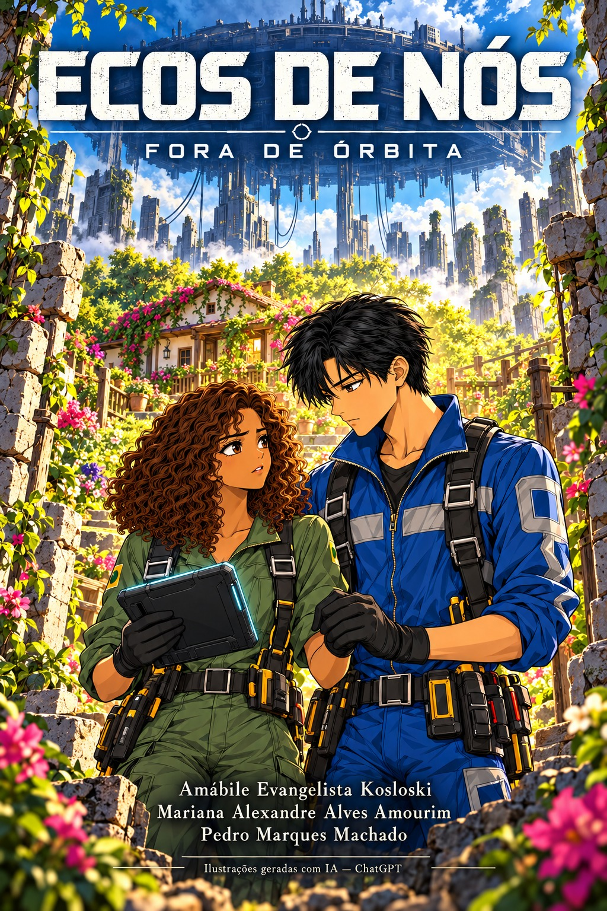

# Ecos de Nós

## Identificação do projeto

- **Nome do grupo:** Fora de Órbita
- **Título da HQ:** Ecos de Nós
- **Tema:** Distopia e ficção científica com romance e mistério.

## Integrantes

- Amábile Evangelista Kosloski
- Mariana Alexandre Alves Amourim
- Pedro Marques Machado

## Descrição do projeto

O projeto consiste na criação de uma história em quadrinhos intitulada **Ecos de Nós**, que acompanha Nina e Ravi em uma jornada de descoberta sobre seu passado e sobre o mundo em que vivem. A narrativa combina mistério, romance e ficção científica para abordar a liberdade de escolha, a importância das memórias e as consequências da exploração ambiental.

Nina e Ravi vivem em uma estação suspensa sobre um planeta considerado inabitável. Responsáveis pela manutenção de máquinas que recolhem recursos da superfície, seguem as ordens de uma central que promete transferi-los para uma colônia segura quando sua missão terminar. Durante um reparo, encontram um jardim escondido entre as ruínas e um dispositivo com gravações dos dois vivendo naquele lugar. Sem lembrar dessa vida, começam a investigar seu passado e descobrem comunidades sobreviventes ameaçadas pelas máquinas que eles próprios mantêm funcionando.

Com a ajuda dos moradores, Nina e Ravi descobrem que tiveram suas memórias alteradas por se oporem à exploração do planeta. Quando a central ordena a destruição do jardim para alcançar uma reserva de energia, o casal organiza um plano para desativar as máquinas e impedir que a estação continue recebendo ordens. Eles conseguem interromper a extração e escapar juntos para a superfície, levando os registros que ajudam a recuperar suas lembranças. Meses depois, o jardim se transforma em um ponto de encontro da comunidade, e os dois passam a morar ali. A última cena mostra Nina e Ravi plantando uma árvore diante da casa que construíram, livres para escolher o futuro que querem compartilhar.

## Objetivos

### Objetivo geral

Criar uma história em quadrinhos de ficção científica e distopia que explore a busca pela identidade e pela liberdade, unindo uma narrativa de mistério a um romance com final feliz.

### Objetivos específicos

- Desenvolver personagens com motivações e conflitos relacionados à recuperação de suas memórias.
- Construir um universo distópico marcado pelo controle da informação e pela exploração dos recursos naturais.
- Estimular a reflexão sobre autonomia, preservação ambiental e os impactos das decisões coletivas.
- Apresentar o vínculo entre Nina e Ravi como parte importante de sua trajetória de descoberta e reconstrução.
- Trabalhar a linguagem dos quadrinhos por meio de roteiro, diálogos, cenários e sequências visuais.
- Desenvolver a criatividade e a colaboração entre os integrantes na produção da HQ.

## Estrutura inicial da história em quadrinhos

A narrativa está organizada em seis etapas e foi desenvolvida em 24 quadros, distribuídos em oito páginas, além da capa.

### 1. Apresentação — A vida na estação

Apresentação de Nina, Ravi e da estação suspensa. Os primeiros quadros mostram a rotina de manutenção das máquinas, as ordens da central e a promessa de transferência para uma colônia segura. A superfície é descrita pela central como inabitável.

### 2. Descoberta — O jardim entre as ruínas

Durante um reparo na superfície, o casal encontra um jardim preservado entre as ruínas. No local, descobre um dispositivo com gravações que mostram os dois vivendo ali, despertando dúvidas sobre suas memórias e sobre as informações recebidas da central.

### 3. Investigação — Os ecos do passado

Nina e Ravi investigam os registros e entram em contato com comunidades sobreviventes. Descobrem que o planeta ainda abriga vida e que as máquinas de extração ameaçam seus moradores. A aproximação com a comunidade revela pistas sobre a antiga vida do casal.

### 4. Revelação e conflito — A ordem de destruição

Com a ajuda dos moradores, os protagonistas descobrem que suas memórias foram alteradas porque se opuseram à exploração do planeta. A central ordena a destruição do jardim para alcançar uma reserva de energia, obrigando o casal a decidir como agir.

### 5. Clímax — A ruptura com a central

Nina, Ravi e os moradores organizam um plano para desativar as máquinas e cortar o recebimento de ordens pela estação. O casal consegue interromper a extração e escapar para a superfície com os registros de seu passado.

### 6. Desfecho — Um futuro escolhido juntos

Meses depois, o jardim se torna um ponto de encontro da comunidade. Nina e Ravi vivem ali e recuperam suas lembranças com a ajuda dos registros. A HQ termina com os dois plantando uma árvore diante da casa que construíram, simbolizando o recomeço e a liberdade de escolher seu futuro.

## Personagens e cenários principais

- **Nina e Ravi:** protagonistas responsáveis pela manutenção das máquinas, que investigam o próprio passado e lutam para proteger a comunidade.
- **Central:** autoridade que controla a estação, transmite ordens e manipula as informações fornecidas ao casal.
- **Moradores da superfície:** comunidade sobrevivente que ajuda os protagonistas a descobrir a verdade e interromper a exploração.
- **Estação suspensa:** local de trabalho e moradia inicial de Nina e Ravi.
- **Superfície do planeta:** ambiente de ruínas e comunidades ameaçadas pela extração de recursos.
- **Jardim:** espaço de descoberta, memória e reconstrução, que se torna o novo lar do casal.

## Planejamento e gerenciamento do projeto

O Product Backlog está registrado nas Issues do GitHub. As tarefas
são acompanhadas no quadro Kanban, e as sprints são organizadas
por Milestones.

- [Quadro Kanban](https://github.com/users/amabilekosloski/projects/2)
- [Product Backlog — Issues](https://github.com/amabilekosloski/Engenharia-de-Software-02-26/issues)
- [Sprints — Milestones](https://github.com/amabilekosloski/Engenharia-de-Software-02-26/milestones)

## Leitura da HQ

A versão disponível contém capa e oito páginas em imagens. A leitura segue da esquerda para a direita e de cima para baixo.

> A revisão PB13 identificou ajustes de texto, atribuição de falas e continuidade ainda pendentes nas imagens. Consulte o [relatório de revisão](docs/pb13-revisao.md). A aprovação final da equipe ainda não foi registrada.

| Parte | Arquivo |
|---|---|
| Capa | [Abrir capa](imagens/capa-ecos.jpeg) |
| Página 1 | [A missão](imagens/sequencia-inicial/pagina01.jpeg) |
| Página 2 | [O jardim](imagens/sequencia-inicial/pagina02.jpeg) |
| Página 3 | [Além da rota](imagens/paginas-montadas/pagina03.png) |
| Página 4 | [O que foi apagado](imagens/paginas-montadas/pagina04.png) |
| Página 5 | [A ordem](imagens/paginas-montadas/pagina05.png) |
| Página 6 | [De volta à estação](imagens/paginas-montadas/pagina06.png) |
| Página 7 | [A ruptura](imagens/paginas-montadas/pagina07.png) |
| Página 8 | [O lugar de voltar](imagens/paginas-montadas/pagina08.png) |

### PDF final

O arquivo PDF da PB14 não está presente na versão revisada. Até sua exportação e publicação, a HQ pode ser lida pelas páginas acima. O link do PDF deverá ser incluído aqui quando o arquivo existir.

## Roteiros e documentação

- [PB04 — Roteiro dos quadros 1 a 6](PB04_Roteiro_Quadrinhos_Iniciais.md)
- [PB07 — Roteiro dos quadros 7 a 24](PB07_Roteiro_Demais_Cenas.md)
- [Fichas dos personagens](fichas-personagens.md)
- [Estilo visual](estilo-visual.md)
- [Prompts de referência](prompts-referencias.md)
- [PB06 — Prompts da sequência inicial](docs/pb06-prompts.md)
- [Prompts das demais cenas](prompts-cenas.md)
- [PB09 — Registro de geração das cenas restantes](docs/pb09-prompts.md)
- [PB11 — Prompts de montagem das páginas 3 a 8](docs/pb11-prompts.md)
- [PB13 — Relatório de revisão](docs/pb13-revisao.md)
- [PB15 — Registro da atualização do README](docs/pb15-documentacao.md)

## Produção visual e créditos

A HQ utiliza traço de mangá colorido, personagens estilizados, contornos definidos e sombreamento em cel-shading. Nina utiliza verde e Ravi azul durante as cenas de manutenção; roupas casuais aparecem nas gravações e no desfecho.

Os registros do projeto documentam o uso de **Gemini** nos testes e etapas iniciais e de **ChatGPT** na geração das cenas restantes e na montagem. A capa também identifica o uso de ChatGPT. Os prompts históricos foram preservados; o guia visual registra a orientação atual de mangá colorido.

**Integrantes:** Amábile Evangelista Kosloski; Mariana Alexandre Alves Amourim; Pedro Marques Machado.

## Situação da revisão e da entrega

- Capa e oito páginas: disponíveis.
- Revisão técnica PB13: realizada, com pendências registradas.
- Aprovação coletiva: a registrar pela equipe após os ajustes.
- Exportação em PDF PB14: pendente na versão analisada.
- Documentação PB15: atualizada; inclusão do link do PDF depende da PB14.
